# Lab 1: Ubuntu Virtual Machine Setup & Troubleshooting Guide

**Aim:** To set up an Ubuntu Linux Virtual Machine using Oracle VirtualBox, resolve common hypervisor and installation errors, and configure core Linux development tools and kernel headers.

---

## 1. Virtual Machine Configuration
- **Hypervisor:** Oracle VirtualBox
- **OS:** Ubuntu 24.04 / 26.04 (64-bit)
- **RAM:** 4096 MB (4 GB)
- **CPU:** 3 Cores
- **Storage:** 25 GB VDI (VirtualBox Disk Image)

### VM Creation & Hardware Allocation
Configuring the virtual machine parameters in Oracle VirtualBox:

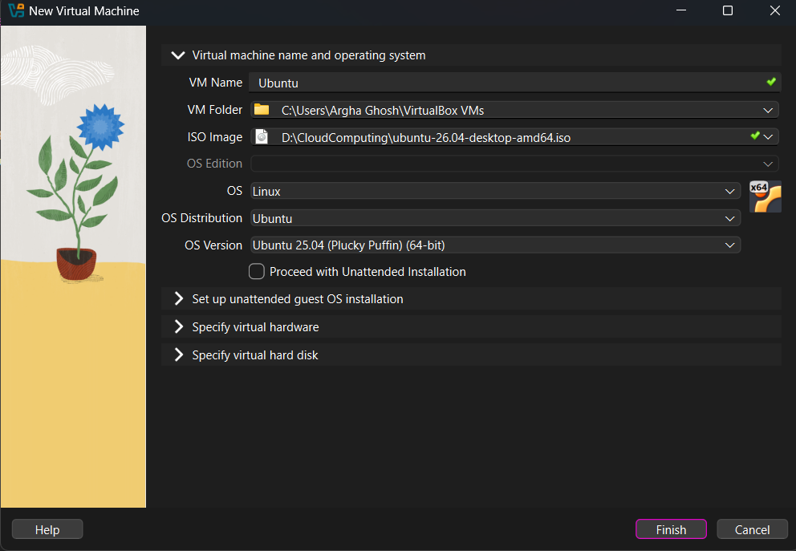
*Figure 1.1: Specifying VM Name, Folder, and Operating System Type.*

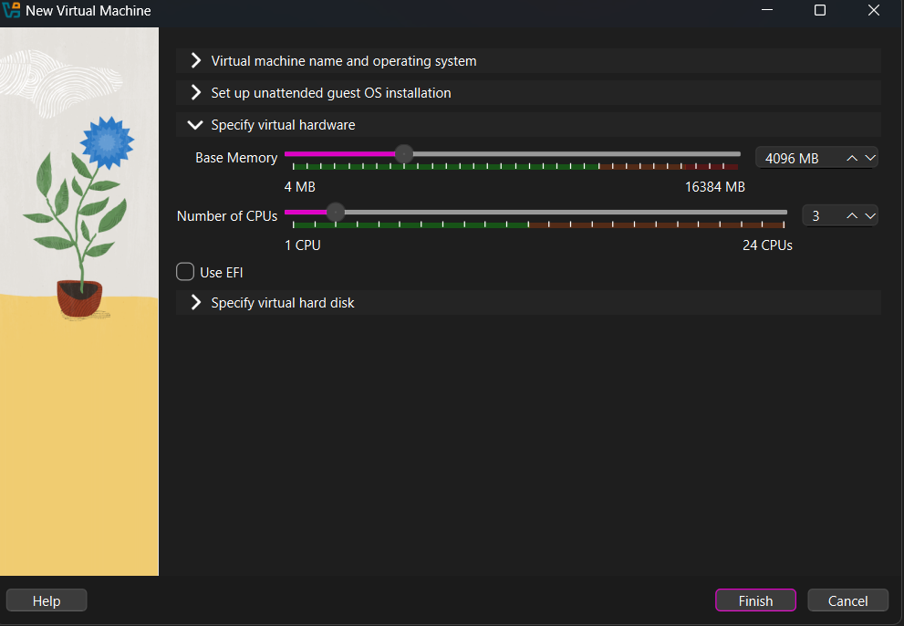
*Figure 1.2: Configuring Virtual Hardware (4 GB RAM, 3 Processors).*

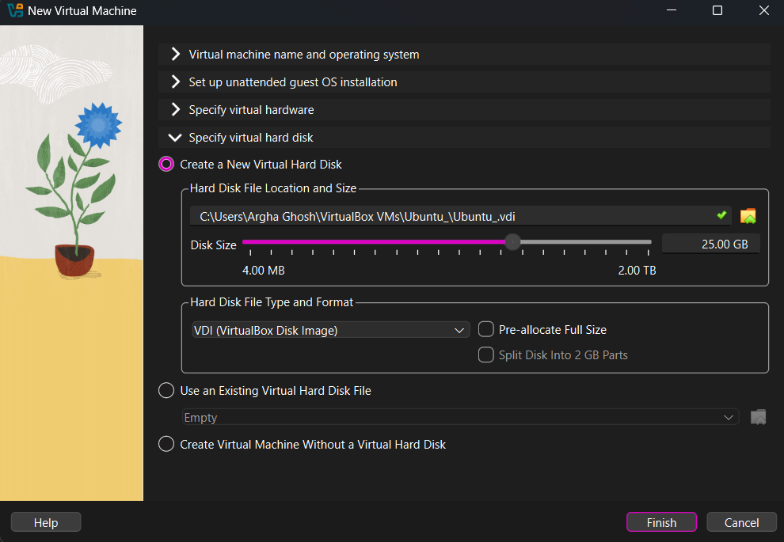
*Figure 1.3: Creating a 25 GB Virtual Hard Disk (VDI).*

---

## 2. Troubleshooting Steps & Installation Fixes

### Issue 1: Installer Crash (`adcli`)
- **Symptom:** The installer crashed during the final system setup phase when attempting to configure `adcli`.
- **Fix:** Disconnected the VirtualBox Network Adapter (set to *"Not attached"*) during the installation phase to bypass network-dependent package failures.

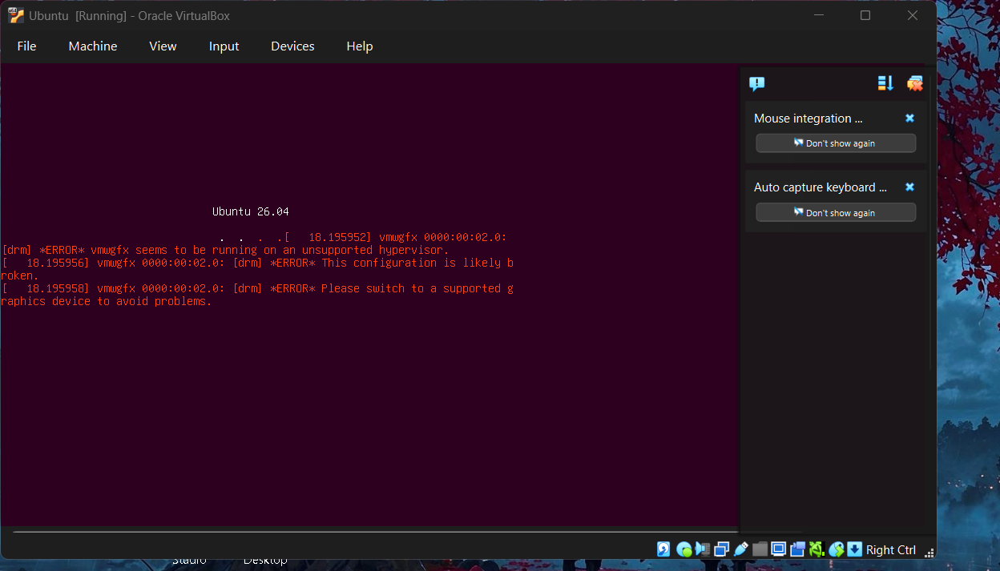
*Figure 1.4: Installer crash during the final system setup phase.*

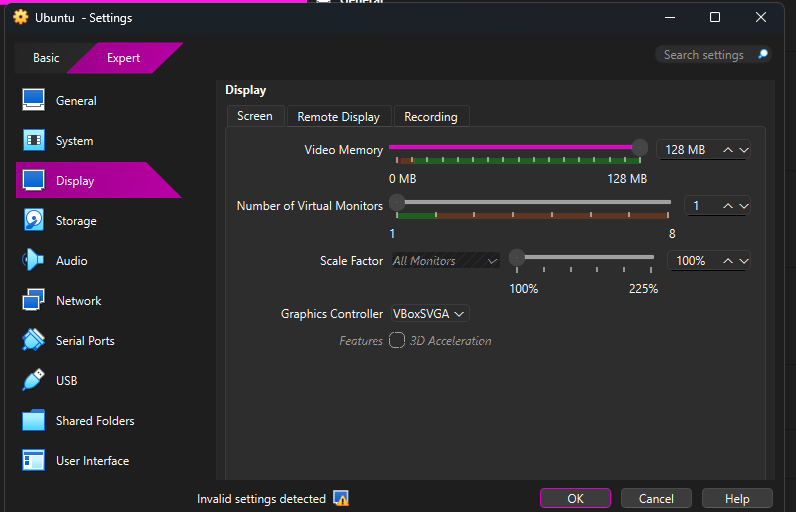
*Figure 1.5: Workaround — Temporarily disabling the VirtualBox network adapter.*

---

### OS Installation Progress
With the network adapter detached, the installer successfully partitioned the disk and deployed system packages:

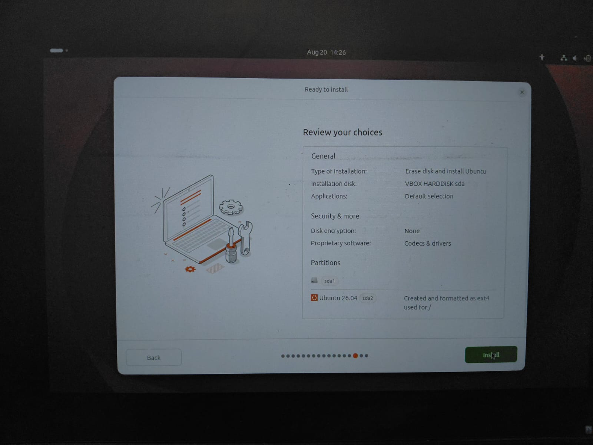
*Figure 1.6: Ubuntu installation configuration and partition setup.*

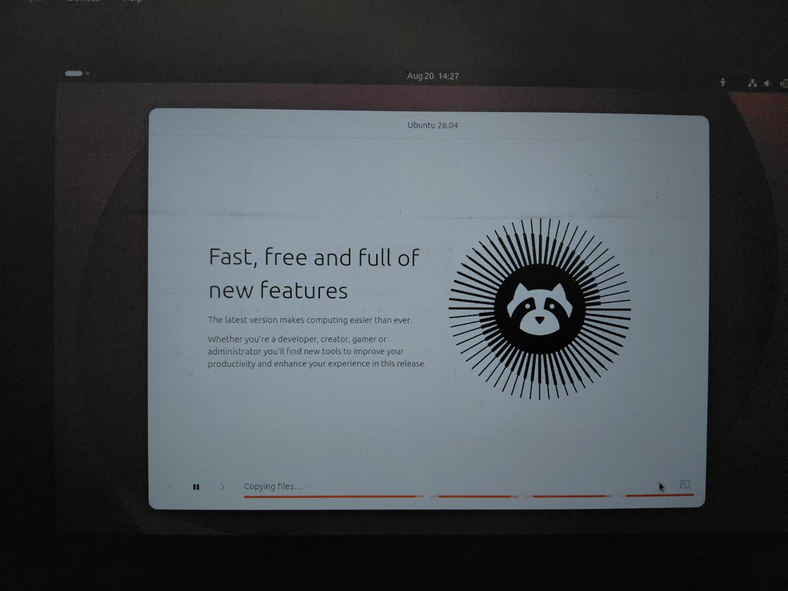
*Figure 1.7: Copying files and installing system packages.*

---

### Issue 2: rsync Data Stream Error
- **Symptom:** Failed during `curtin extract` phase with an `rsync` error in data stream.
- **Fix:** Ensured the Ubuntu ISO was properly mounted to the IDE controller, wiped broken partitions, and selected *Erase disk and install Ubuntu* for a clean install.

### Issue 3: Graphics Controller Conflict (`vmwgfx`)
- **Symptom:** System booted into a text screen displaying `vmwgfx seems to be running on an unsupported hypervisor`.
- **Fix:** Navigated to **VM Settings > Display**. Changed Graphics Controller to **VBoxSVGA**, increased Video Memory to **128MB**, and disabled **3D Acceleration** to force clean software rendering.

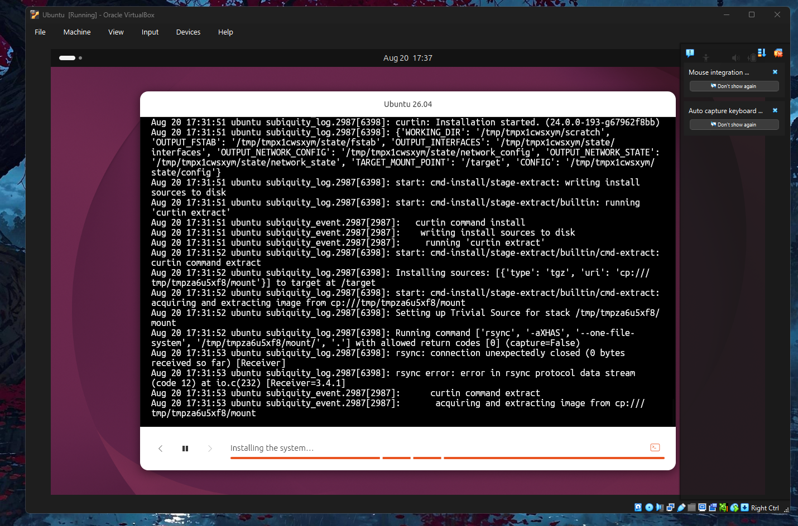
*Figure 1.8: Boot error showing hypervisor graphics incompatibility.*

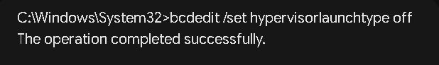
*Figure 1.9: VirtualBox Display Settings adjusted to VBoxSVGA and 128MB Video Memory.*

### Issue 4: Black Screen & Windows Hypervisor Conflict
- **Symptom:** The VM froze on a black screen after kernel logs.
- **Fix:** Disabled Windows Hyper-V and Core Isolation on the host machine using command prompt: `bcdedit /set hypervisorlaunchtype off`. Rebooted the host PC to give VirtualBox direct virtualization access.

---

## 3. Finalizing Installation
After resolving the hypervisor and display issues, the Ubuntu installation completed successfully.

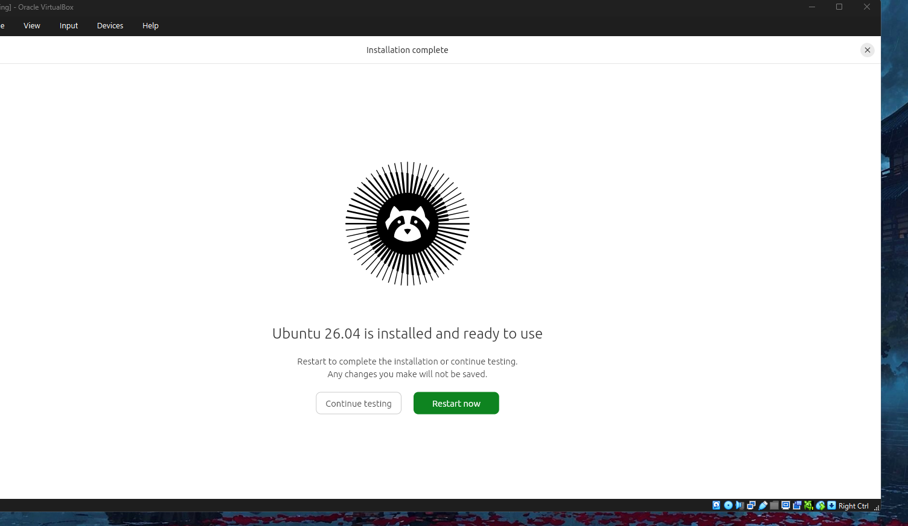
*Figure 1.10: Ubuntu installation completed successfully.*

---

## 4. Post-Installation: Build Tools and Kernel Headers
Once booted into the new Ubuntu environment, the network adapter was re-enabled (**NAT mode**). The final task was to install the prerequisite build tools for C compilation and kernel development:

```bash
sudo apt update
sudo apt install -y build-essential linux-headers-$(uname -r)
```

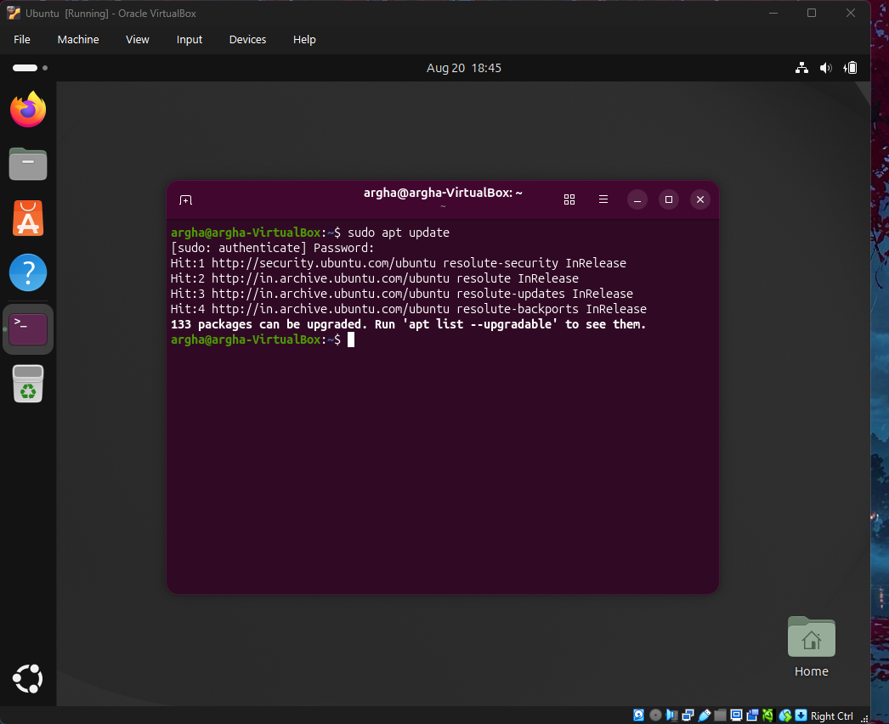
*Figure 1.11: Executing `sudo apt update` to refresh repository package indexes.*

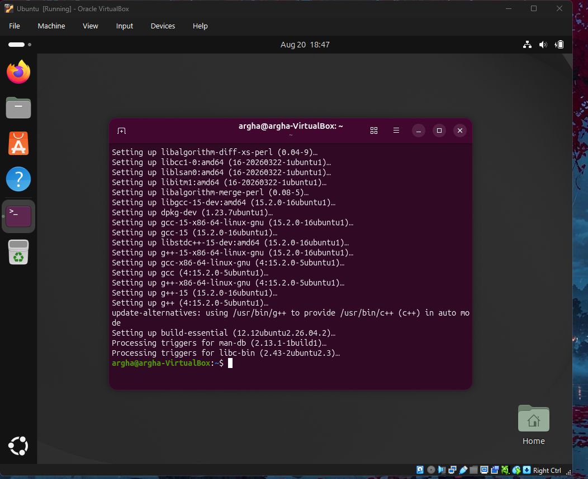
*Figure 1.12: Successfully installing `build-essential` and matching Linux kernel headers.*
