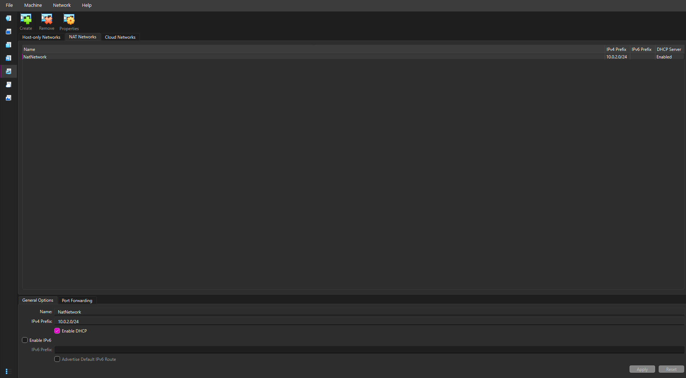
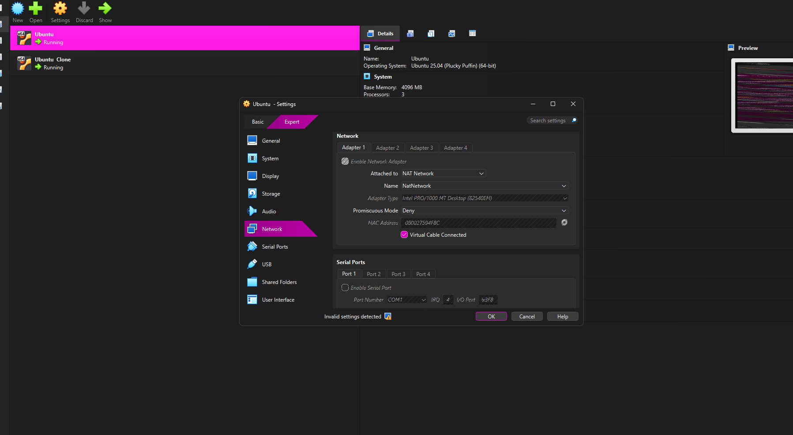
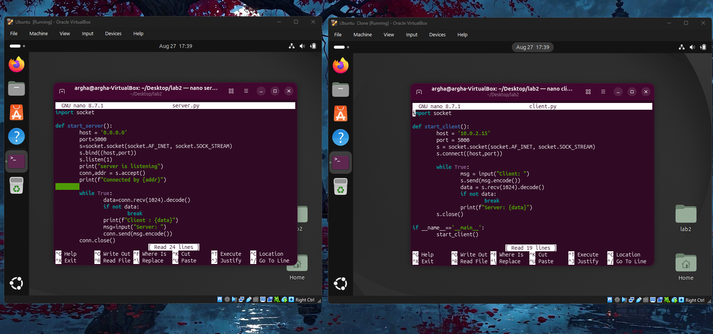
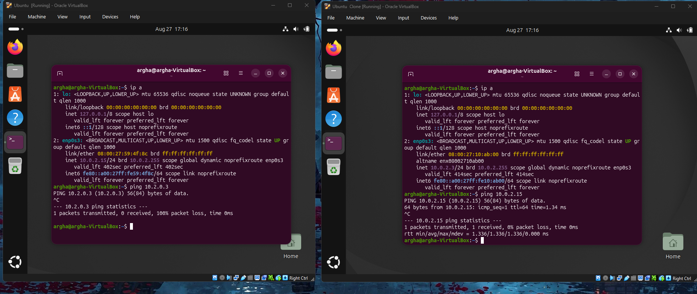
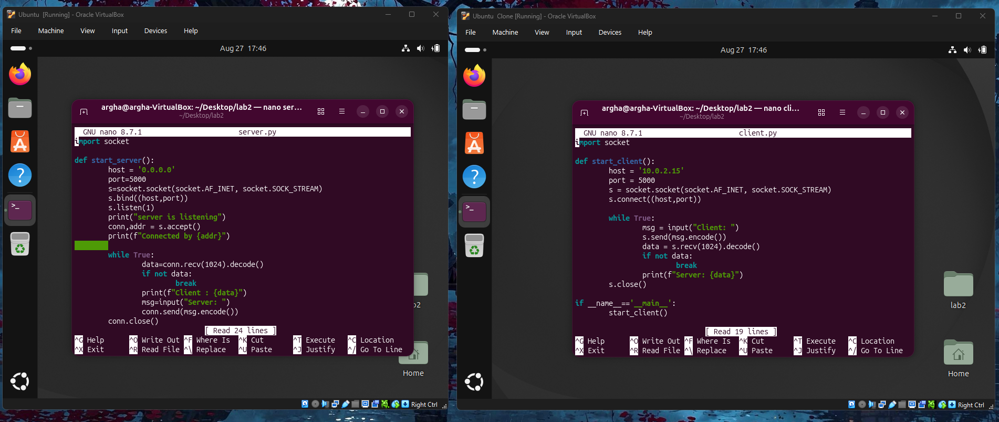
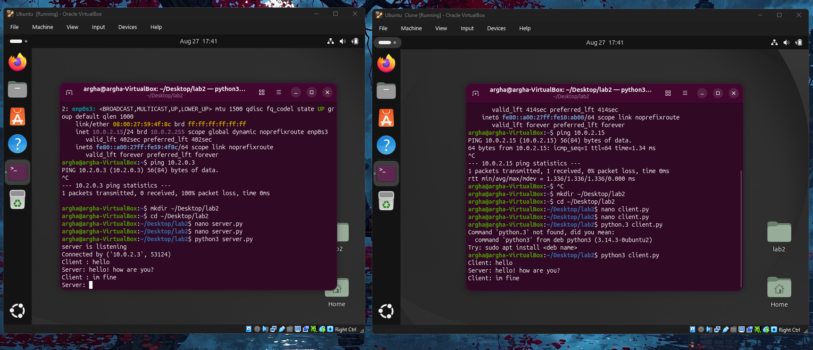
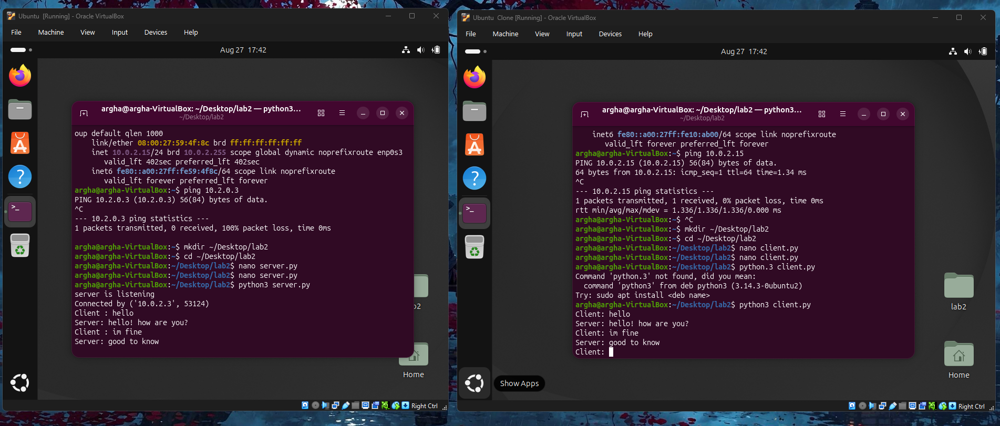

# Lab 2: Client-Server TCP Socket Communication Between Virtual Machines

**Aim:** To establish a private virtual network between two VirtualBox Linux virtual machines and develop a bidirectional client-server chat application using Python TCP network sockets.

---

## Architecture & Overview
* **Virtual Machine 1 (Server):** Ubuntu VM running `server.py`
* **Virtual Machine 2 (Client):** Cloned Ubuntu VM running `client.py`
* **Network Mode:** VirtualBox NAT Network (`10.0.2.0/24`) with DHCP enabled
* **Transport Protocol:** Transmission Control Protocol (TCP) / IPv4 Sockets

---

## Phase 1: Virtual Machine & Network Configuration
1. Created a clone of the initial Ubuntu Virtual Machine to act as the second node.
2. Created a dedicated **NAT Network** named `NatNetwork` with IPv4 CIDR prefix `10.0.2.0/24` and DHCP enabled.
3. Attached both Virtual Machines to `NatNetwork` via VirtualBox **Settings > Network > Attached to: NAT Network**.


*Figure 2.1: Cloned Ubuntu Virtual Machine in VirtualBox Manager.*


*Figure 2.2: NAT Network configuration dialog (`10.0.2.0/24`).*


*Figure 2.3: Assigning both VMs to the shared NAT Network.*

---

## Phase 2: Connectivity & System Access
1. Booted both VMs and inspected their dynamically assigned IP addresses using `ip a`:
   - **Server IP:** `10.0.2.4` (or assigned DHCP IP)
   - **Client IP:** `10.0.2.15` (or assigned DHCP IP)
2. Verified point-to-point IP connectivity across the NAT network using `ping -c 4 <server-ip>`.


*Figure 2.4: Verifying network interface IP addresses (`ip a`) on both nodes.*


*Figure 2.5: ICMP ping test confirming zero packet loss between VMs.*

---

## Phase 3: Workspace Preparation
Created a dedicated workspace directory on both virtual machines:
```bash
mkdir -p ~/Desktop/lab2
cd ~/Desktop/lab2
```

---

## Phase 4: TCP Socket Application Implementation
Developed Python TCP socket scripts using the `socket` module.

### Server Implementation (`server.py`)
```python
import socket

server_socket = socket.socket(socket.AF_INET, socket.SOCK_STREAM)
server_socket.setsockopt(socket.SOL_SOCKET, socket.SO_REUSEADDR, 1)
server_socket.bind(("0.0.0.0", 12345))
server_socket.listen(1)

print("Server is listening on port 12345...")
conn, addr = server_socket.accept()
print(f"Connected by {addr}")

while True:
    data = conn.recv(1024).decode()
    if not data or data.lower() == "exit":
        print("Client disconnected.")
        break
    print(f"Client: {data}")
    reply = input("Server: ")
    conn.send(reply.encode())
    if reply.lower() == "exit":
        break

conn.close()
server_socket.close()
```

### Client Implementation (`client.py`)
```python
import socket

client_socket = socket.socket(socket.AF_INET, socket.SOCK_STREAM)
SERVER_IP = "10.0.2.4"  # Replace with the actual Server VM IP
PORT = 12345

client_socket.connect((SERVER_IP, PORT))
print("Connected to server. Type 'exit' to quit.")

while True:
    msg = input("Client: ")
    client_socket.send(msg.encode())
    if msg.lower() == "exit":
        break
    reply = client_socket.recv(1024).decode()
    if not reply or reply.lower() == "exit":
        print("Server closed connection.")
        break
    print(f"Server: {reply}")

client_socket.close()
```


*Figure 2.6: Implementing socket logic in `server.py` and `client.py` using `nano`.*

---

## Phase 5: Execution & Demonstration
1. Started the server on VM 1:
   ```bash
   python3 server.py
   ```
2. Executed the client on VM 2:
   ```bash
   python3 client.py
   ```
3. Verified real-time bidirectional communication.


*Figure 2.7: Establishing socket connection between Server and Client.*


*Figure 2.8: Bidirectional chat session running over TCP/IP sockets.*

---

## Conclusion
Both Ubuntu virtual machines were configured in an isolated NAT network and successfully exchanged real-time TCP messages, demonstrating practical IaaS network virtualization and socket-level inter-process communication.
