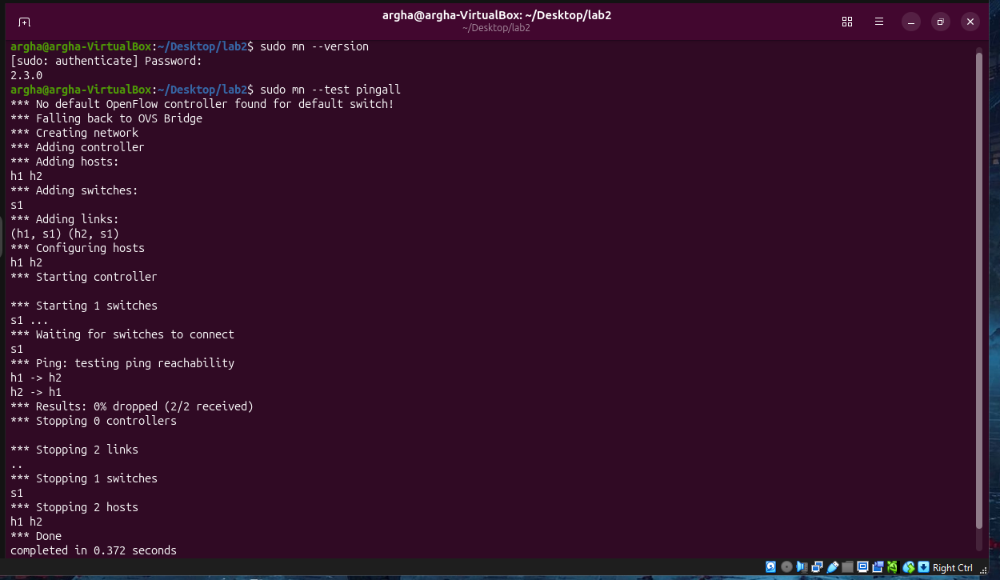
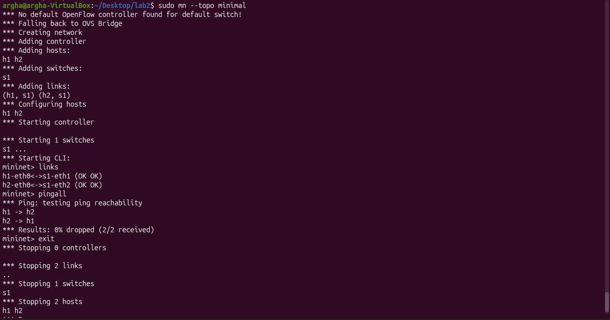
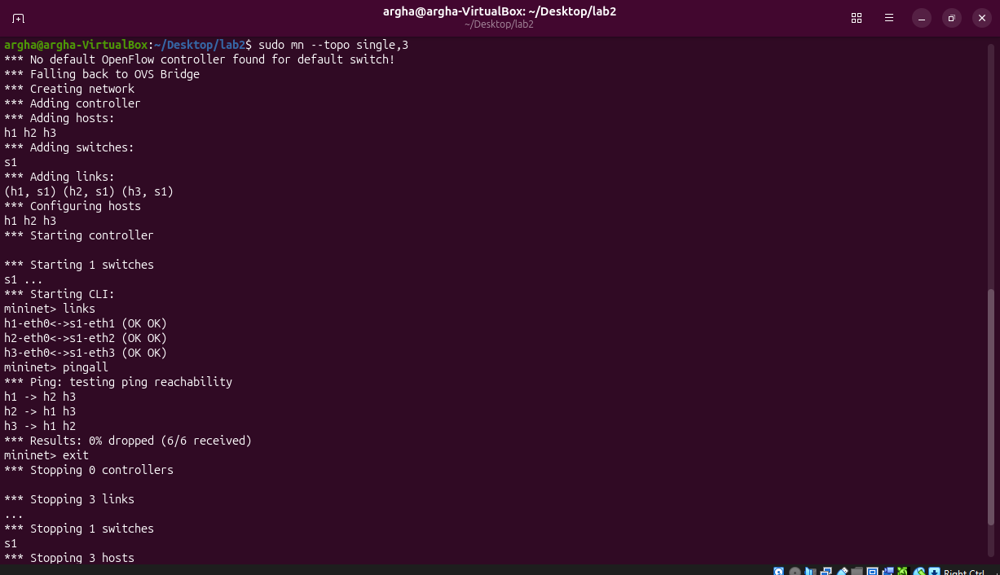
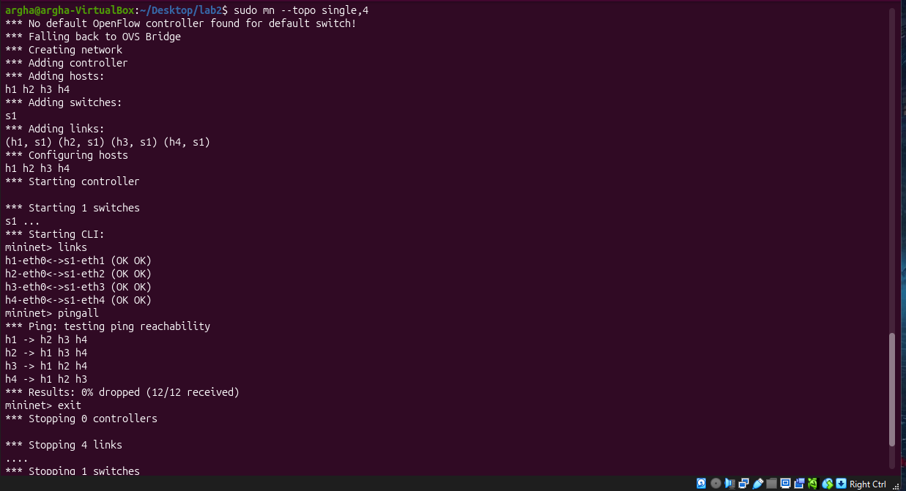
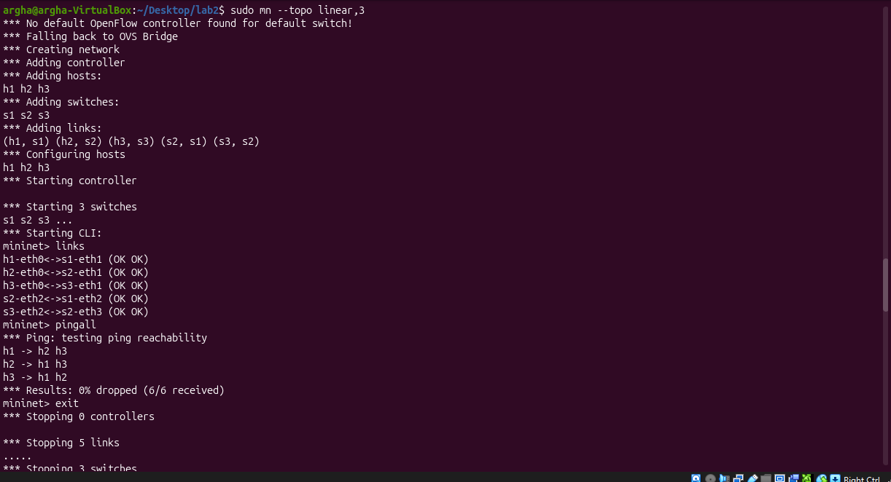
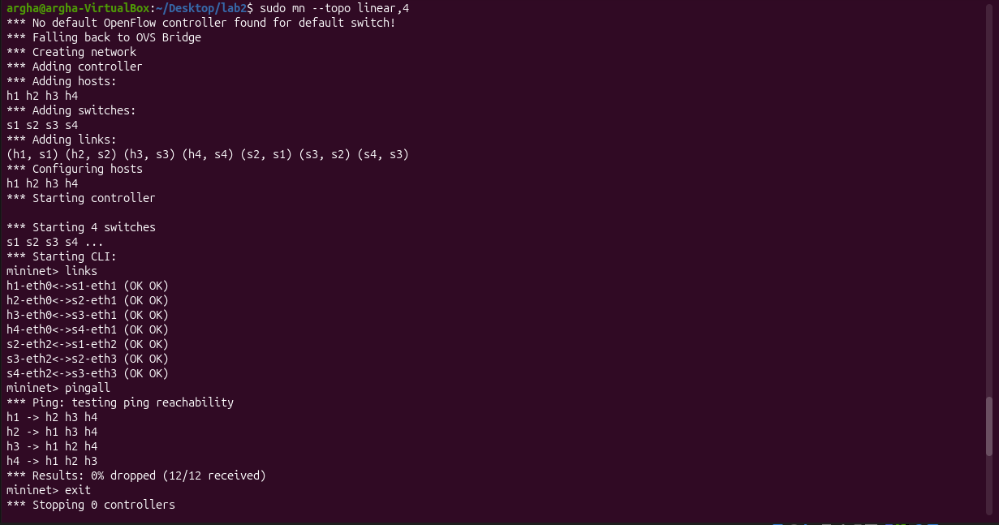
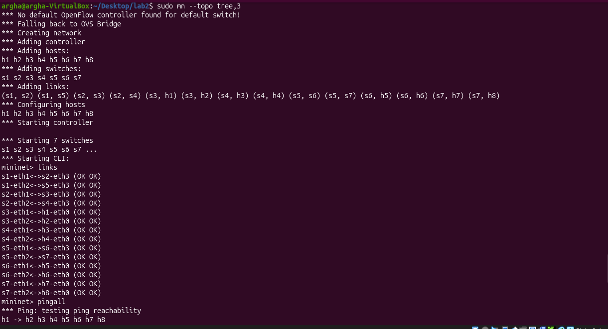
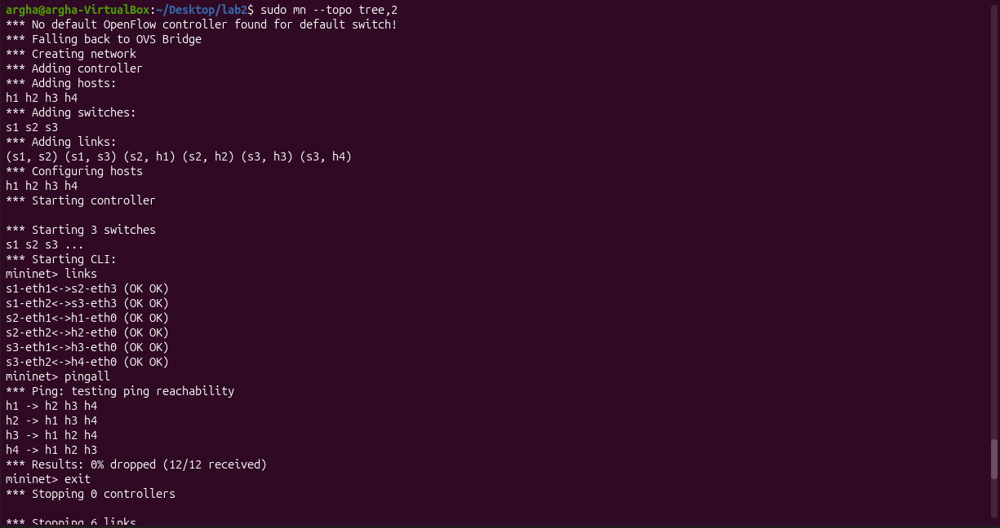
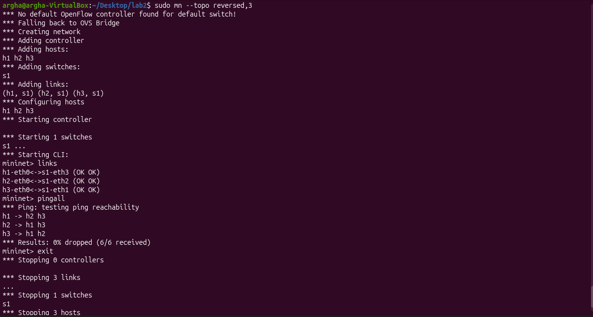
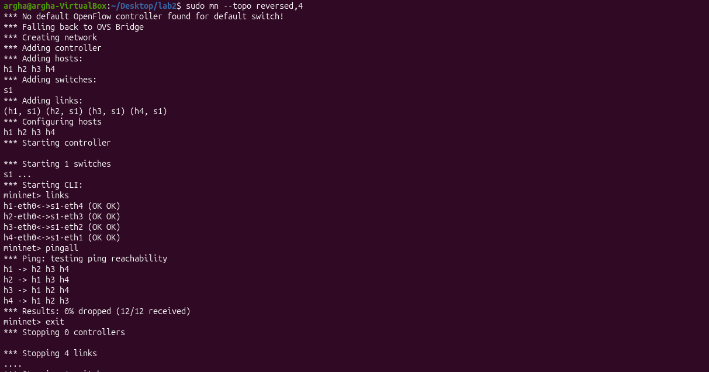

# Lab 3: Network Topology Emulation Using Open-Source Network Virtualization (Mininet)

**Aim:** To create, configure, and inspect different network topologies using the open-source network virtualization tool **Mininet**, and verify end-to-end communication across virtual switches and hosts.

---

## Environment & Prerequisites
* **Hypervisor:** Oracle VirtualBox
* **Operating System:** Ubuntu Linux Virtual Machine
* **Virtualization Tool:** Mininet 2.3.x+ / Open vSwitch

---

## Part 1: Installation and Verification
Updated Ubuntu repository indexes, installed Mininet, and verified basic connectivity:
```bash
sudo apt-get update
sudo apt-get install mininet -y
sudo mn --version
sudo mn --test pingall
```


*Figure 3.1: Verifying Mininet installation and initial `pingall` self-test.*

---

## Part 2: Network Topology Configurations

### 1. Minimal Topology
Default baseline topology consisting of 1 switch and 2 hosts (`s1` connected to `h1`, `h2`):
```bash
sudo mn --topo minimal
```
*Inside Mininet CLI:*
```text
mininet> pingall
mininet> exit
```
Clean up:
```bash
sudo mn -c
```


*Figure 3.2: Minimal topology creation, link status, and `pingall` verification.*

---

### 2. Single Topology
A central switch connected to $k$ hosts.

#### Configuration A (3 Hosts):
```bash
sudo mn --topo single,3
mininet> links
mininet> pingall
mininet> exit
sudo mn -c
```


*Figure 3.3: Single topology with 3 hosts connected to 1 switch.*

#### Configuration B (4 Hosts):
```bash
sudo mn --topo single,4
mininet> links
mininet> pingall
mininet> exit
sudo mn -c
```


*Figure 3.4: Single topology with 4 hosts connected to 1 switch.*

---

### 3. Linear Topology
A line of $k$ switches, each connected to adjacent switches and exactly one host.

#### Configuration A (3 Nodes):
```bash
sudo mn --topo linear,3
mininet> links
mininet> pingall
mininet> exit
sudo mn -c
```


*Figure 3.5: Linear topology with 3 switches and 3 hosts.*

#### Configuration B (4 Nodes):
```bash
sudo mn --topo linear,4
mininet> links
mininet> pingall
mininet> exit
sudo mn -c
```


*Figure 3.6: Linear topology with 4 switches and 4 hosts.*

---

### 4. Tree Topology
Hierarchical switch tree structure branching downwards to leaf hosts.

#### Configuration A (Depth 3: 7 switches, 8 hosts):
```bash
sudo mn --topo tree,3
mininet> links
mininet> pingall
mininet> exit
sudo mn -c
```


*Figure 3.7: Hierarchical tree topology of depth 3.*

#### Configuration B (Depth 2: 3 switches, 4 hosts):
```bash
sudo mn --topo tree,2
mininet> links
mininet> pingall
mininet> exit
sudo mn -c
```


*Figure 3.8: Hierarchical tree topology of depth 2.*

---

### 5. Reversed Topology
Reversed internal link ordering compared to standard single/tree topologies.

#### Configuration A (3 Hosts):
```bash
sudo mn --topo reversed,3
mininet> links
mininet> pingall
mininet> exit
sudo mn -c
```


*Figure 3.9: Reversed topology with 3 hosts.*

#### Configuration B (4 Hosts):
```bash
sudo mn --topo reversed,4
mininet> links
mininet> pingall
mininet> exit
sudo mn -c
```


*Figure 3.10: Reversed topology with 4 hosts.*

---

## Conclusion
All five network topologies (Minimal, Single, Linear, Tree, Reversed) were successfully synthesized and evaluated. In every topology, link connectivity was confirmed with `links` and zero packet loss (`0% dropped`) was verified via `pingall`.
