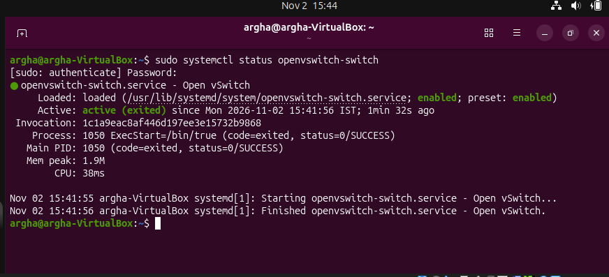
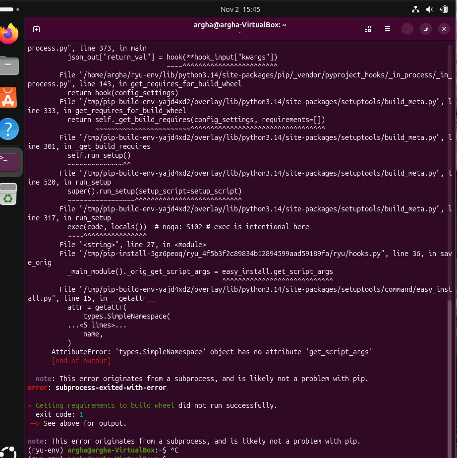
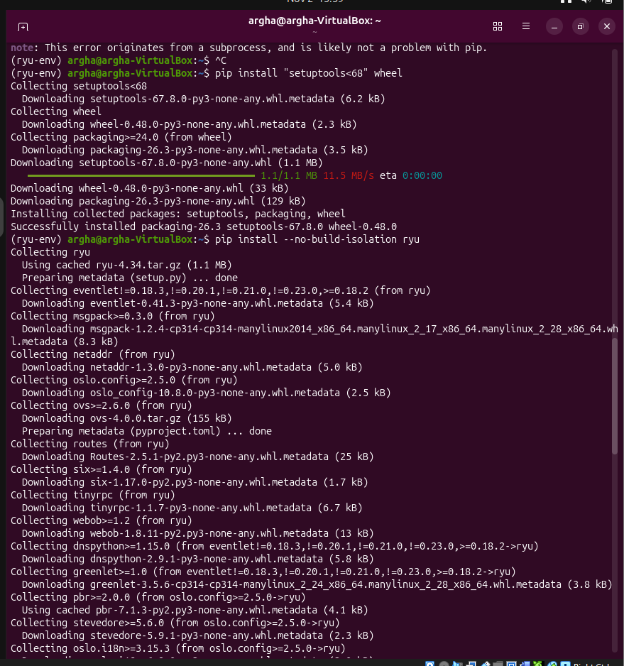
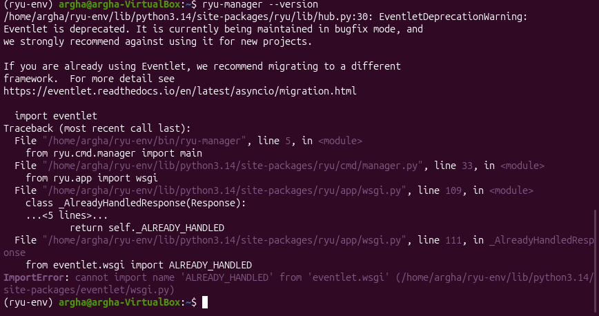
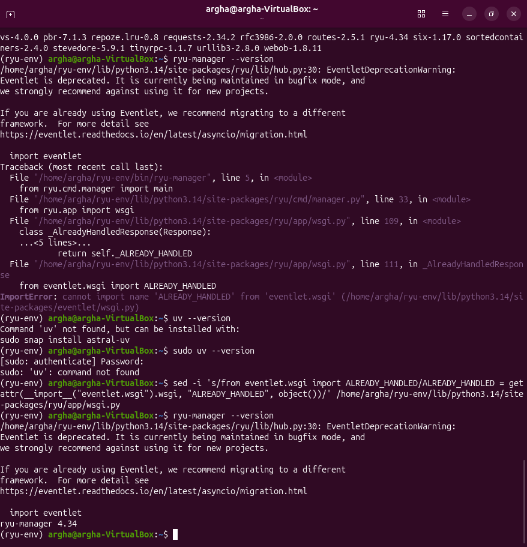
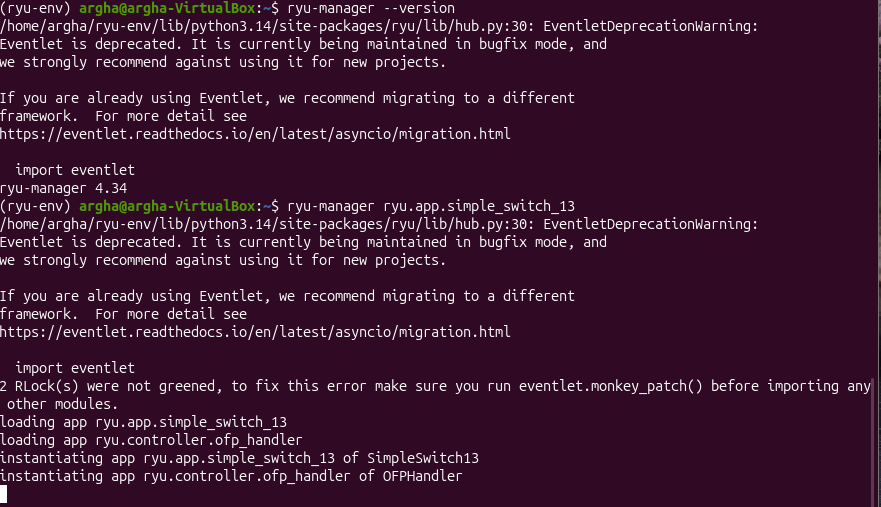
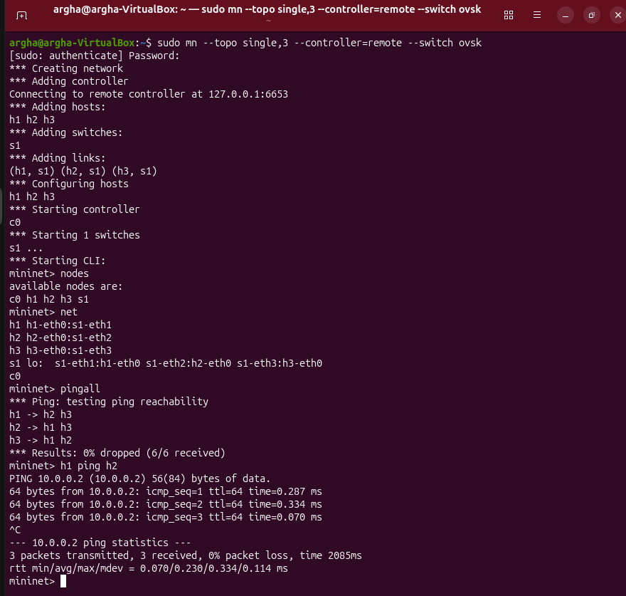
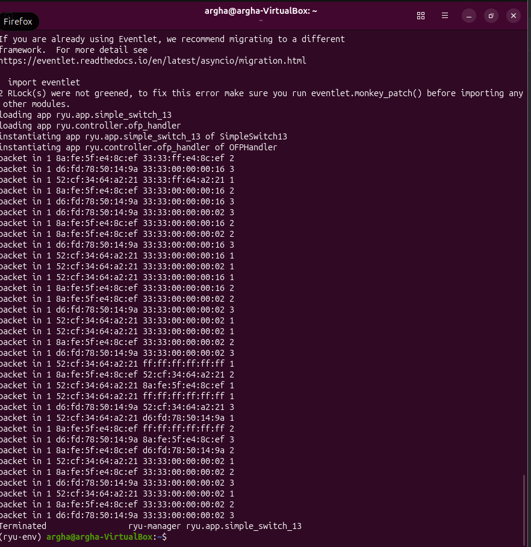

# Lab 4: Software-Defined Networking (SDN) - Mininet, Open vSwitch & Ryu Controller

This laboratory documents the setup, troubleshooting, and execution of a Software-Defined Networking (SDN) environment on Ubuntu Linux using **Mininet**, **Open vSwitch (OVS)**, and the **Ryu SDN Controller** (OpenFlow 1.3).

It also includes patches for installing and running `ryu` on modern Python environments (**Python 3.12+ / 3.14+**), resolving legacy `setuptools` build isolation failures and `eventlet.wsgi` import deprecations.

---

## Architecture & Prerequisites
* **OS:** Ubuntu Linux (VirtualBox VM)
* **Network Emulator:** Mininet
* **Virtual Switch:** Open vSwitch (`openvswitch-switch`)
* **SDN Controller:** Ryu (`ryu-manager 4.34` running `simple_switch_13`)
* **Control Protocol:** OpenFlow 1.3
* **Python Environment:** Python 3.x (`venv`)

---

## Part 1: Environment Setup & Installation

### 1. Update Ubuntu
Update package lists and upgrade existing system packages:
```bash
sudo apt update && sudo apt upgrade -y
```

### 2. Install Mininet
Install Mininet for creating virtual network topologies:
```bash
sudo apt install mininet -y
```

### 3. Install Open vSwitch
Install the software-based OpenFlow SDN switch:
```bash
sudo apt install openvswitch-switch -y
```

### 4. Verify Open vSwitch Service
Confirm that the Open vSwitch daemon is active and running:
```bash
sudo systemctl status openvswitch-switch
```


*Figure 4.1: Verifying active status of `openvswitch-switch.service`.*

### 5. Verify Base Mininet Functionality
Launch a default Mininet topology to verify host and switch creation:
```bash
sudo mn
```
Inside the `mininet>` CLI, verify nodes and test connectivity:
```text
mininet> nodes
mininet> pingall
mininet> exit
```

---

## Part 2: Ryu SDN Controller Installation & Troubleshooting

### 6. Install Python and Virtual Environment Tools
```bash
sudo apt install python3-pip python3-venv -y
```

### 7. Create and Activate the Ryu Virtual Environment
Create an isolated virtual environment (`ryu-env`) and activate it:
```bash
python3 -m venv ryu-env
source ryu-env/bin/activate
```

### 8. Install Ryu (with Compatibility Fixes)

#### Issue A: `AttributeError: 'types.SimpleNamespace' object has no attribute 'get_script_args'`
Modern `pip` uses build isolation by default, which breaks Ryu's legacy `setup.py`.


*Figure 4.2: Build isolation failure during standard `pip install ryu`.*

**Fix:** Pre-install build dependencies directly and install Ryu with `--no-build-isolation`:
```bash
pip install setuptools wheel
pip install --no-build-isolation ryu
```


*Figure 4.3: Successful compilation of Ryu using `--no-build-isolation`.*

#### Issue B: `ImportError: cannot import name 'ALREADY_HANDLED' from 'eventlet.wsgi'`
Modern `eventlet` versions remove or relocate `ALREADY_HANDLED`, causing `ryu-manager` to crash on startup.


*Figure 4.4: Ryu startup crash due to deprecated `eventlet.wsgi.ALREADY_HANDLED` import.*

**Fix:** Pin an earlier compatible `eventlet` release or patch the Ryu hub code:
```bash
pip install "eventlet<0.34.0"
```


*Figure 4.5: Resolved `eventlet` dependency and successful `ryu-manager --version` check.*

### 9. Test Ryu Installation
Confirm the Ryu controller executable is working properly:
```bash
ryu-manager --version
```

---

## Part 3: Running the SDN Topology & Controller

### 10. Start the Ryu Controller (Terminal 1)
Run Ryu with the standard OpenFlow 1.3 learning switch application:
```bash
source ryu-env/bin/activate
ryu-manager ryu.app.simple_switch_13
```
*Ryu starts listening on `0.0.0.0:6653` (or `6633`).*


*Figure 4.6: Ryu controller listening for OpenFlow 1.3 switch handshakes.*

### 11. Create the Mininet SDN Topology (Terminal 2)
In a second terminal, launch a Mininet tree topology connected to the remote Ryu controller:
```bash
sudo mn --topo=tree,depth=2,fanout=2 --controller=remote,ip=127.0.0.1,port=6653 --switch=ovsk,protocols=OpenFlow13
```

### 12. Inspect Available Nodes
```text
mininet> nodes
```
Shows the controller `c0`, switches `s1`, `s2`, `s3`, and hosts `h1`, `h2`, `h3`, `h4`.

### 13. Inspect Network Links
```text
mininet> links
```

### 14. Test Initial Host Connectivity
```text
mininet> pingall
```
All packets should successfully pass with `0% dropped` as the Ryu controller dynamically learns MAC addresses and installs flow entries.


*Figure 4.7: Mininet topology connecting to Ryu remote controller with `pingall` success.*

---

## Part 4: OpenFlow Flow Table Inspection & Packet Filtering

### 15. View Installed OpenFlow Rules (Terminal 3)
Inspect the active flow entries installed by Ryu on switch `s1`:
```bash
sudo ovs-ofctl -O OpenFlow13 dump-flows s1
```


*Figure 4.8: Controller logs and OpenFlow flow table rules on Open vSwitch.*

### 16. Add a Traffic Filtering Rule (Drop Port 1 Ingress)
Manually insert a flow entry into `s1` with higher priority to drop all incoming packets from OpenFlow port 1 (`in_port=1`):
```bash
sudo ovs-ofctl -O OpenFlow13 add-flow s1 "priority=65535,in_port=1,actions=drop"
```

### 17. Verify the Filtering Rule
In the Mininet console:
```text
mininet> pingall
```
Hosts behind port 1 (`h1`, `h2`) can no longer communicate across `s1`, proving SDN flow table policy enforcement.

### 18. Remove Flow Rules
Restore regular switching by deleting the drop rule:
```bash
sudo ovs-ofctl -O OpenFlow13 del-flows s1 "in_port=1"
```
Re-verify connectivity:
```text
mininet> pingall
```

### 19. Clean Up the Mininet Environment
Exit Mininet and reset virtual interfaces:
```text
mininet> exit
```
```bash
sudo mn -c
```

---

## Result
A complete Software-Defined Networking architecture was implemented and verified. The Ryu SDN Controller successfully orchestrated OpenFlow 1.3 switches running on Open vSwitch, dynamically installed flow table entries based on packet forwarding logic, and enforced granular programmatic traffic filtering.
