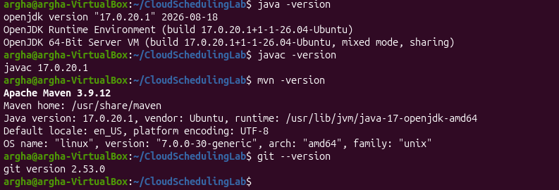
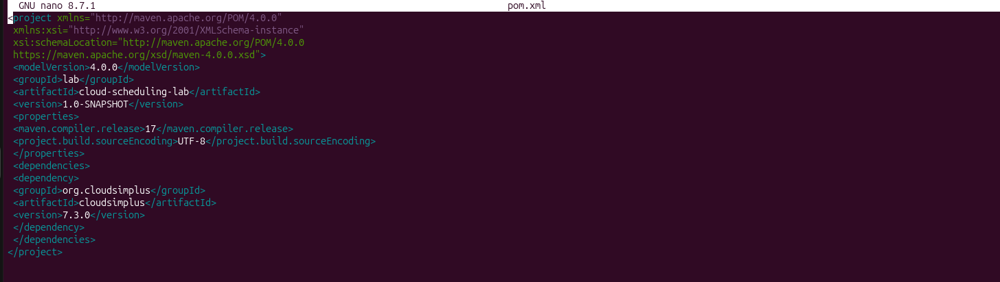
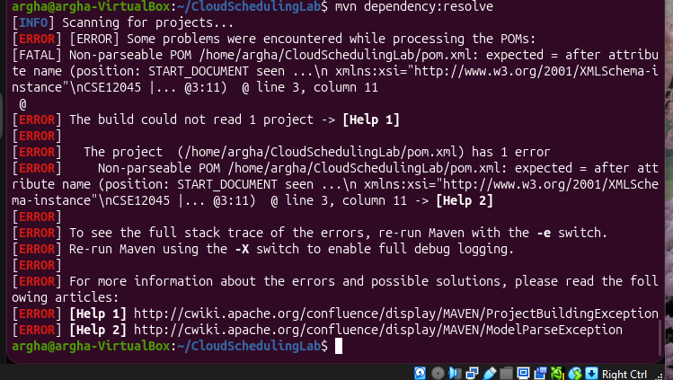
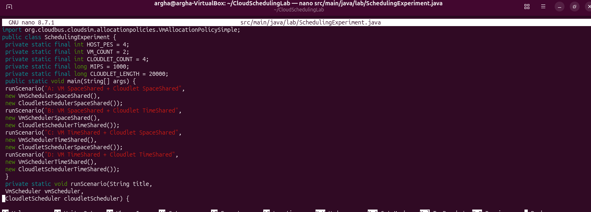
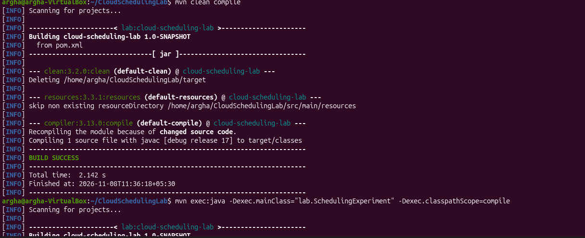
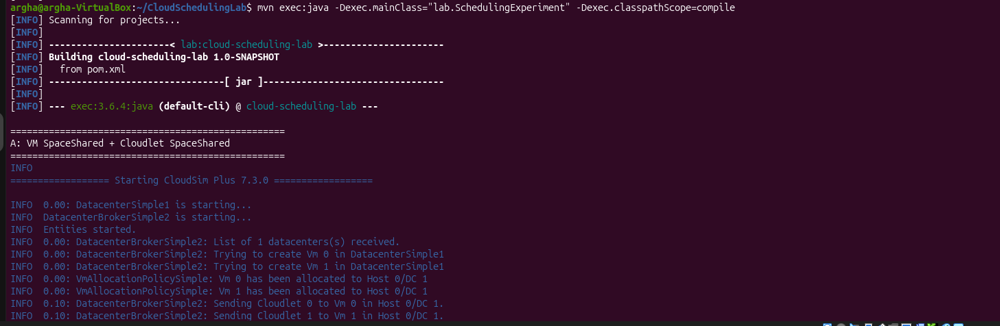
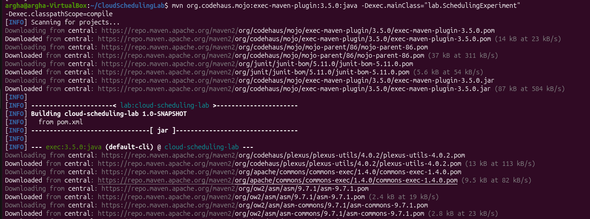

# Lab 5: Cloud Resource Scheduling Simulation Using CloudSim Plus

**Aim:** To simulate and evaluate combinations of Virtual Machine (VM) and Cloudlet scheduling policies in a cloud datacenter environment using the open-source **CloudSim Plus** simulation framework.

---

## 1. System Update & Prerequisites
Configured the Java and Maven environment on Ubuntu:

```bash
sudo apt update && sudo apt upgrade -y
sudo apt install openjdk-17-jdk maven git -y
```

Verified the toolchain versions:
```bash
java -version
javac -version
mvn -version
git --version
```


*Figure 5.1: Verifying Java 17, Maven, and Git installations.*

---

## 2. Directory Structure Setup
Established the standard Maven directory structure:
```bash
mkdir -p src/main/java/lab
```

---

## 3. Maven Configuration (`pom.xml`)
Created the project definition file specifying CloudSim Plus version `8.5.5` and Java 17 compilation target:

```xml
<project xmlns="http://maven.apache.org/POM/4.0.0"
         xmlns:xsi="http://www.w3.org/2001/XMLSchema-instance"
         xsi:schemaLocation="http://maven.apache.org/POM/4.0.0 
         http://maven.apache.org/xsd/maven-4.0.0.xsd">
    <modelVersion>4.0.0</modelVersion>

    <groupId>lab</groupId>
    <artifactId>cloud-scheduling-lab</artifactId>
    <version>1.0-SNAPSHOT</version>

    <properties>
        <maven.compiler.release>17</maven.compiler.release>
        <project.build.sourceEncoding>UTF-8</project.build.sourceEncoding>
    </properties>

    <dependencies>
        <dependency>
            <groupId>org.cloudsimplus</groupId>
            <artifactId>cloudsimplus</artifactId>
            <version>8.5.5</version>
        </dependency>
    </dependencies>
</project>
```


*Figure 5.2: Configuring `pom.xml` with CloudSim Plus 8.5.5 dependency.*

Resolved dependencies and cleaned previous build targets:
```bash
mvn dependency:resolve
mvn clean
```


*Figure 5.3: Downloading CloudSim Plus and transitive dependencies into `~/.m2/repository`.*

---

## 4. Experiment Implementation (`SchedulingExperiment.java`)
Implemented the four scheduling policy combinations in `src/main/java/lab/SchedulingExperiment.java`:

| Scenario | VM Scheduling Policy (`VmScheduler`) | Cloudlet Scheduling Policy (`CloudletScheduler`) | Description |
| :--- | :--- | :--- | :--- |
| **Scenario A** | `VmSchedulerSpaceShared` | `CloudletSchedulerSpaceShared` | Dedicated PEs to VMs; Cloudlets queue sequentially on VMs. |
| **Scenario B** | `VmSchedulerSpaceShared` | `CloudletSchedulerTimeShared` | Dedicated PEs to VMs; Cloudlets share VM capacity concurrently. |
| **Scenario C** | `VmSchedulerTimeShared` | `CloudletSchedulerSpaceShared` | Time-sliced host PEs across VMs; Cloudlets queue on VMs. |
| **Scenario D** | `VmSchedulerTimeShared` | `CloudletSchedulerTimeShared` | Full concurrent resource sharing at both host and VM levels. |


*Figure 5.4: Implementing `SchedulingExperiment.java` simulation logic.*

---

## 5. Build & Execution

### 5.1 Compile
Compiled the Java source code against the resolved CloudSim Plus classpath:
```bash
mvn clean compile
```


*Figure 5.5: Successful compilation with Maven (`BUILD SUCCESS`).*

### 5.2 Execute Simulation
Executed the simulation using the Maven Exec Plugin:
```bash
mvn org.codehaus.mojo:exec-maven-plugin:3.5.0:java -Dexec.mainClass="lab.SchedulingExperiment"
```


*Figure 5.6: Simulation output for Scenarios A & B.*


*Figure 5.7: Simulation output for Scenarios C & D and comparison results.*

---

## 6. Common Pitfalls & Solutions

| Error | Root Cause | Solution |
| :--- | :--- | :--- |
| `Non-parseable POM ... expected = after attribute name` | Stray PDF text accidentally copied into `pom.xml`. | Inspect the line indicated in the error and remove stray text. |
| `package org.cloudbus.cloudsim... does not exist` | Unresolved `cloudsimplus` dependency in `pom.xml`. | Check `<dependencies>` in `pom.xml` and rerun `mvn dependency:resolve`. |
| `CloudletScheduler already has a Vm assigned to it` | Sharing a single scheduler instance across multiple VMs. | Instantiate a new scheduler instance inside the VM creation loop for each VM. |

---

## Conclusion
The simulation successfully evaluated the impact of Space-Shared versus Time-Shared scheduling at both the host (VM) and virtual machine (Cloudlet) levels, illustrating task queuing delays, concurrent timeslicing, and overall makespan characteristics in cloud datacenters.
